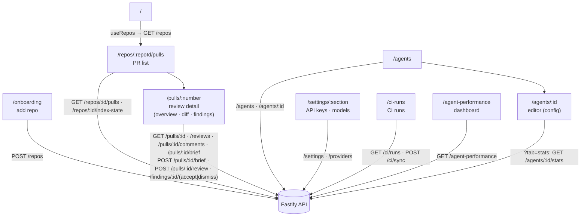

# `@devdigest/web` — the studio (Next.js 15)

The DevDigest UI: import repos, browse pull requests, run and read AI reviews,
and author agents. App Router + React Server/Client components, data via
**TanStack Query** hooks over the Fastify API. (This is the starter surface;
course lessons add the Skills, Memory, Eval, Blast/Brief, multi-agent, CI, and
dashboard screens.)

- **Stack:** Next.js 15 (App Router), React 19, TanStack Query, `next-intl`
  (messages in `messages/<locale>/*.json`), `recharts`, `mermaid`,
  `react-markdown`. UI primitives are vendored under `src/vendor/ui`
  (`@devdigest/ui`) and shared Zod contracts under `src/vendor/shared`
  (`@devdigest/shared`).
- **API base:** `NEXT_PUBLIC_API_BASE` (default `http://localhost:3001`), used by
  `src/lib/api.ts`. Every data hook lives in `src/lib/hooks/*`.
- **Run:** `pnpm dev` (`:3000`). **Test:** `pnpm test` (vitest + jsdom, fetch
  mocked — no API needed). **Typecheck:** `pnpm typecheck`.

## UI route map

Routes (`src/app/**/page.tsx`) and the API surface each leans on (via
`src/lib/hooks/*` → `src/lib/api.ts`):

The PR detail Overview tab renders the PR Brief card (`_components/PrBriefCard`);
its file/line refs deep-link to `?tab=diff&file=<path>&line=<n>`, which opens and
highlights that file in the Files changed tab.

Cross-cutting chrome lives in `src/components/app-shell` (nav, breadcrumbs,
`g`-then-key shortcuts). Pages are thin; feature logic sits in colocated
`_components/<Name>/` folders, each with its own `*.test.tsx`.

## Evals

Eval pipeline UI (SPEC-03). Data comes from `src/lib/hooks/evals.ts` (TanStack
Query hooks over `src/lib/api.ts`); shared pieces live in `src/components/evals`
(`MetricStrip`, `ScoringNote`, `RunEvalControl`, `RunDetailDrawer`, `EvalDialog`,
and pure helpers such as `latestFinished` / `previousFinished` / `passedParts`).

| Where | What |
|---|---|
| `/evals` | Dashboard: every agent's latest numbers and recent runs (`EvalOverview`). |
| `/evals/[agentId]` | One agent: metric cards, run history, run detail drawer, compare dialog (`AgentEvalPage`). |
| `/agents/[id]?tab=evals` | Agent Evals tab (`EvalsTab`): case list, metric strip, Run all evals, last 10 runs; a run row opens the same run detail drawer. |
| Finding cards (PR detail) | "Turn into eval case" opens `EvalCaseDialog`, prefilled from `GET /findings/:id/eval-case-draft`. |
| `/repos/[repoId]/multi-agent` | Configure run: pick a PR and 1 to 5 agents, see the estimate, launch (`ConfigureRun`). |
| `/repos/[repoId]/multi-agent/[id]?view=columns\|tabs` | Multi-agent results: per-agent columns or tabs, plus "Where agents disagree" (`MultiAgentResults`). |

"Cases passed" is always `cases_passed / counts.cases_scored`; the metric cards derive
latest/previous from the runs list (finished runs only), so a failed run never
shows as "latest".

Message namespaces (`messages/en/`): `evalsShared` (strip, scoring note, run
control), `evalsTab` (agent tab), `evalsDashboard` (dashboard, drawer, compare).

Test ids used by the e2e flows (`e2e/specs/12-agent-evals-tab.flow.json`,
`13-eval-dashboard-compare.flow.json`): `eval-case-row`, `eval-case-kind`,
`eval-metric-recall|precision|citation|passed`, `eval-run-button`,
`eval-dashboard-link`, `eval-agent-row`, `eval-run-select`, `eval-compare-button`,
`eval-compare-dialog`, `eval-compare-delta`, `eval-prompt-del`, `eval-prompt-ins`,
`eval-dashboard-compare`.

## Agent performance

Agent Performance dashboard and the agent Stats tab (SPEC-06). Data comes from `src/lib/hooks/agent-performance.ts` (GET only: `GET /agent-performance`, `GET /agents/:id/stats`); shared pieces and pure helpers (period, format, sort, breakdown) live in `src/components/agent-performance`. The sidebar item is in the "SKILLS LAB" group (no shortcut).

| Where | What |
|---|---|
| `/agent-performance?range=1d\|30d\|custom&start=YYYY-MM-DD&end=YYYY-MM-DD` | Dashboard (`AgentPerformanceView`): applied period, four cards, per-agent table, cost breakdowns; an unknown period falls back to 30 days. Custom dates are UTC days. |
| `/agents/[id]?tab=stats&from=<iso>&to=<iso>` | Stats tab (`StatsTab`) for the exact window; the dashboard's View link carries the instants of its response, so both pages show the same numbers. Without `from`/`to` it shows the last 30 days. |

Costs are always labelled "Estimate"; a copy-scan test (`src/test/agent-performance-copy.test.ts`) keeps "billed", "actual", "invoiced" and "reconciled" out of the labels. Message namespaces: `agentPerformance` and `runs.stats`.

## Testing

Component/interaction tests (`*.test.tsx`) run under vitest + jsdom with `fetch`
mocked, so they need neither the API nor a browser. The real browser journeys
(client + API + seeded DB) are covered by the deterministic agent-browser suite
in [`../e2e`](../e2e/README.md) and the `e2e-web.yml` workflow. See
[`../TESTING.md`](../TESTING.md).

## Export to CI (SPEC-05)

Hooks live in `src/lib/hooks/ci.ts`; shared UI in `src/components/ci-export`
(`ExportCiWizard`: Target, Preview, Configure, Install; `CiRunsTable`). The
client mirrors the shared CI constants locally (runtime imports from
`@devdigest/shared` break `next build`). Messages: `ciExport`, `ciRuns`.

| Route | What it shows |
|---|---|
| `/ci-runs` | The workspace's 100 newest CI runs (`CiRunsView`); one sync on open, Refresh button, per-repository sync warnings. |
| `/agents/[id]?tab=ci` | Agent CI tab (`CiTab`): installations, "Config changed since export" + Update CI config, Fail CI on, 20 recent runs, Add to CI wizard. |
